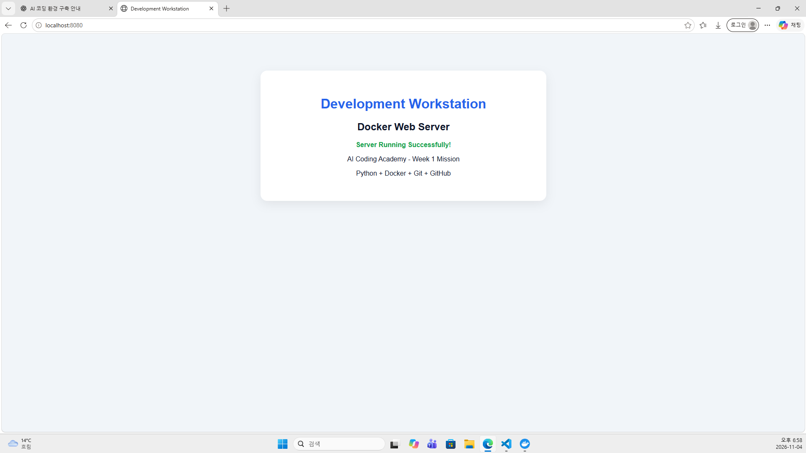
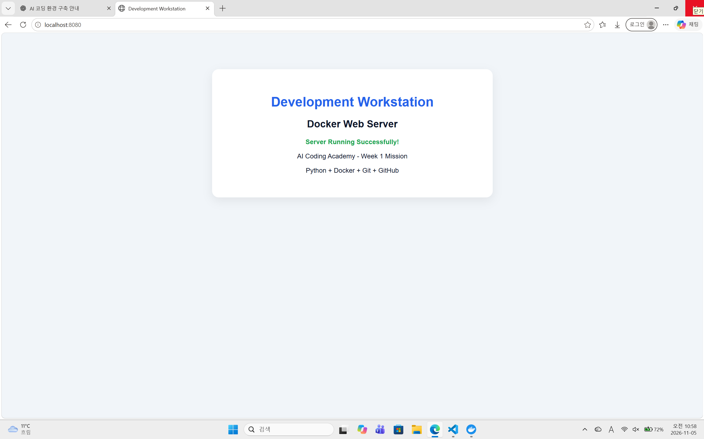
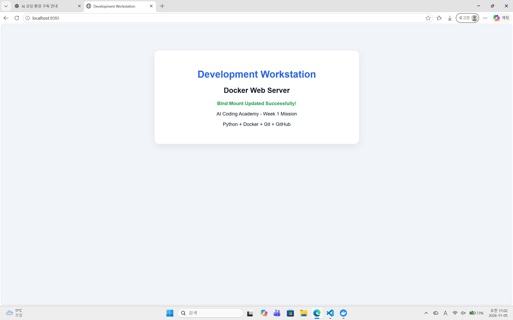

# Development Workstation

## 1. 프로젝트 개요

코디세이아카데미 AI 코딩 교육 프로그램의 1주차 개발 워크스테이션 구축 미션입니다.

Windows 11 환경에서 PowerShell, VS Code, Git, WSL 2, Docker Desktop을 설치하고, Dockerfile 기반 Python 웹 서버를 구축했습니다.

또한 포트 매핑, 바인드 마운트, Docker 볼륨 영속성 및 GitHub 버전 관리 기능을 검증했습니다.

## 2. 개발 환경

| 구분 | 환경 및 버전 |
|---|---|
| 운영체제 | Windows 11 (빌드 26300.9711) |
| CPU 아키텍처 | AMD64 |
| RAM | 32GB |
| 터미널 및 쉘 | VS Code 통합 터미널 / Windows PowerShell |
| PowerShell 버전 | 5.1.26100.9711 |
| VS Code | 1.145.0 |
| Git | 2.56.0.windows.4 |
| WSL | 3.0.3.0 |
| Linux 배포판 | Ubuntu / WSL 2 |
| Docker | 29.9.2 |
| 웹 서버 | Python 3.12 기반 HTTP 서버 |

## 3. 수행 항목 체크리스트

- [x] VS Code 및 Git 설치
- [x] Git 기본 브랜치 main 설정
- [x] WSL 2 설치 및 Ubuntu 실행
- [x] Docker Desktop 설치 및 엔진 점검
- [x] Dockerfile 기반 웹 서버 이미지 빌드
- [x] Docker 컨테이너 실행
- [x] 호스트 8080 → 컨테이너 8000 포트 매핑
- [x] 브라우저 접속 성공
- [x] 바인드 마운트 변경 반영 검증
- [x] Docker 볼륨 영속성 검증
- [x] GitHub 저장소 생성 및 원격 연결
- [x] 터미널 및 권한 검증 증거 최종 정리
- [x] GitHub 첫 커밋 및 푸시
- [ ] 공개 저장소 최종 검수

## 4. 프로젝트 구조

```text
development-workstation/
├── app/
│   └── index.html
├── Dockerfile
├── .gitignore
├── README.md
├── docs/
└── evidence/
```

`docs/`에는 터미널 및 트러블슈팅 문서를 저장하고, `evidence/`에는 검증 로그와 스크린샷을 저장합니다.

## 5. Docker 웹 서버 구축

### 이미지 빌드

```powershell
docker build -t workstation-web:1.0 .
```

### 컨테이너 실행

```powershell
docker run -d --name workstation-web -p 127.0.0.1:8080:8000 workstation-web:1.0
```

### 브라우저 접속

http://localhost:8080

호스트의 8080번 포트를 컨테이너 내부의 8000번 포트에 연결했습니다.

### 접속 성공 증거



## 6. Docker 설치 및 운영 검증

다음 명령어를 사용하여 Docker 환경을 점검했습니다.

```powershell
docker --version
docker info
docker images
docker ps -a
docker logs workstation-web
docker stats --no-stream
```
### Docker 운영 검증 증거

- [Docker 버전](evidence/docker-version.txt)
- [Docker hello-world 실행 로그](evidence/docker-hello-logs.txt)
- [Docker 이미지 목록](evidence/web-images.txt)
- [Docker 컨테이너 목록](evidence/web-containers.txt)
- [Docker 웹 서버 로그](evidence/web-server-logs.txt)
- [Docker 리소스 통계](evidence/web-stats.txt)
- [터미널 및 권한 검증](evidence/terminal-permissions.txt)
실행 결과는 `evidence/` 폴더에 보관합니다.

## 7. 바인드 마운트 검증

Windows 호스트의 `app` 폴더를 컨테이너의 `/app` 디렉터리에 연결했습니다.

```powershell
docker run -d --name workstation-bind -p 127.0.0.1:8080:8000 --mount "type=bind,source=$((Get-Location).Path)\app,target=/app" workstation-web:1.0
```

호스트의 `index.html`을 수정한 후 이미지 재빌드 없이 웹페이지 변경 사항이 반영되는 것을 확인했습니다.

### 변경 전



### 변경 후



## 8. Docker 볼륨 영속성 검증

### 볼륨 생성

```powershell
docker volume create workstation-data
```

### 볼륨 연결

```powershell
docker run -d --name workstation-volume-new --mount type=volume,source=workstation-data,target=/data python:3.12-slim sleep infinity
```

### 데이터 저장 및 확인

컨테이너 내부 `/data/test.txt`에 `Persistent data test` 문자열을 저장하고 읽었습니다.

### 컨테이너 삭제 및 재생성

기존 컨테이너를 삭제한 뒤 동일한 볼륨을 새 컨테이너에 연결했습니다.

```powershell
docker run -d --name workstation-volume-verify --mount type=volume,source=workstation-data,target=/data python:3.12-slim sleep infinity
```

### 데이터 확인

```powershell
docker exec workstation-volume-verify cat /data/test.txt
```

출력:

```text
Persistent data test
```

컨테이너 삭제 전후 데이터가 동일함을 확인했습니다.

증빙 자료:

- [삭제 전 데이터](evidence/volume-before.txt)
- [삭제 후 데이터](evidence/volume-after.txt)
- [영속성 비교 결과](evidence/volume-verification.txt)

## 9. Git 및 GitHub 연동

Git 사용자 이름과 이메일, 기본 브랜치를 설정했습니다.

```powershell
git config --global init.defaultBranch main
git init
git remote -v
```

원격 저장소:

https://github.com/classfirst/development-workstation

## 10. 트러블슈팅

### 사례 1. Docker Engine 연결 실패

**문제**

`docker build` 실행 시 Docker Linux Engine의 Named Pipe 연결 오류가 발생했습니다.

**원인 가설**

Docker Desktop이 실행되지 않았거나 Docker Engine이 준비되지 않았을 가능성을 검토했습니다.

**확인**

```powershell
docker info
docker context ls
```

**해결 및 결과**

Docker Desktop의 실행 상태와 엔진 연결을 점검한 뒤 Docker 이미지 빌드에 성공했습니다.

정확한 원인 확정 여부는 추가 로그를 기준으로 판단합니다.

### 사례 2. Docker 볼륨 파일 미발견

**문제**

```text
cat: /data/test.txt: No such file or directory
```

**원인 가설**

파일이 생성되지 않았거나 볼륨 연결에 문제가 있을 가능성을 검토했습니다.

**확인**

```powershell
docker inspect workstation-volume-new --format '{{json .Mounts}}'
docker exec workstation-volume-new ls -l /data
```

**해결**

볼륨 연결을 확인하고 `/data/test.txt` 파일을 다시 생성했습니다.

**검증 결과**

파일 읽기에 성공했으며, 기존 컨테이너 삭제 후 새 컨테이너에서도 동일한 데이터를 확인했습니다.

## 11. 최종 결론

Windows 11 기반 개발 워크스테이션을 구축하고 Dockerfile, 포트 매핑, 바인드 마운트 및 Docker 볼륨 영속성을 검증했습니다.

소스코드, 기술 문서, 운영 로그와 증빙 자료를 GitHub 저장소에 정리하여 개발 환경의 재현성과 검증 가능성을 확보하는 것을 목표로 합니다.
